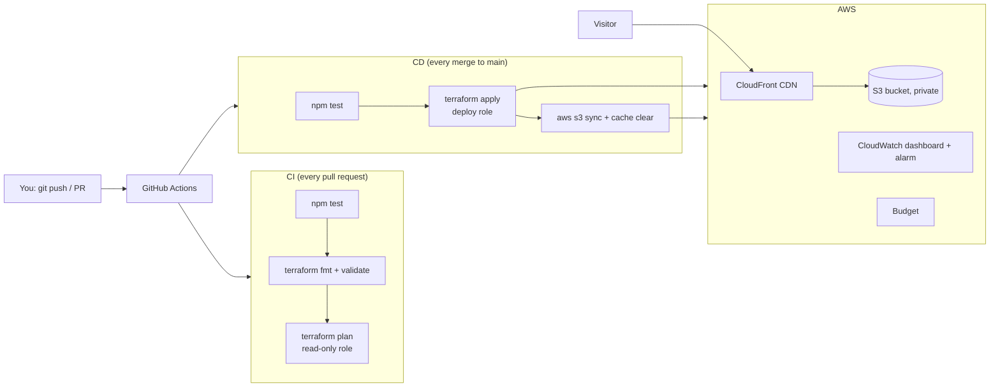

# modern_web_deployment

Drop HTML, CSS, images and PDFs into `site/`, open a pull request, and the
platform does the rest: tests run, Terraform shows what would change in AWS,
and after the merge the site is deployed to a global CDN.

This repository is also a **hands-on introduction to Terraform**. Every `.tf`
file is commented, and the [docs](#learning-path) explain what happens at each
level, from "what is Terraform" to "which API call does this line cause".

## How it fits together



| Folder | What it is |
| --- | --- |
| `site/` | The website. Anything here is uploaded as-is. |
| `tests/` | Site tests (`npm test`). Required to pass before merging. |
| `infra/bootstrap/` | One-time Terraform stack you run locally: state bucket, AWS roles for CI, GitHub settings. |
| `infra/live/` | The Terraform stack CI plans and applies: hosting, monitoring, budget. Its settings are in `terraform.tfvars`. |
| `infra/modules/aws/` | Reusable building blocks (`static-site`, `monitoring`). Future modules for webserver, database, auth go here. |
| `.github/workflows/` | `ci.yml` (pull requests) and `deploy.yml` (main). |
| `docs/` | The learning material and the roadmap. |

## Quick start

You need an AWS account, a GitHub token, Terraform 1.10+ and the AWS CLI.
Full instructions are in [docs/00-getting-started.md](docs/00-getting-started.md).

```bash
aws configure                       # or export AWS_PROFILE=...
export GITHUB_TOKEN=github_pat_...  # fine-grained token for this repo
cp infra/bootstrap/terraform.tfvars.example infra/bootstrap/terraform.tfvars
make bootstrap                      # creates state bucket, CI roles, GitHub variables
```

Then run the **Deploy** workflow from the Actions tab (or push to main). The
workflow summary shows the URL of your hello-world page.

## Learning path

1. [Getting started](docs/00-getting-started.md): credentials, bootstrap, first deploy, tear-down.
2. [Terraform primer](docs/01-terraform-primer.md): what Terraform does in this project, from the big picture down to single lines.
3. [Making changes](docs/02-making-changes.md): edit a `.tf` file, read the plan, see what changes in AWS. Six worked examples.
4. [Switching clouds](docs/03-switching-clouds.md): what changes in the code when the same site runs on GCP or Azure.
5. [Webserver roadmap](docs/04-webserver-roadmap.md): the phased plan for EC2, S3 media, RDS Postgres, load balancer and logins.

## Cost

With the defaults (no custom domain) the prototype costs close to nothing:
S3 storage of a few MB, CloudFront within its free tier (1 TB and 10 million
requests a month), one dashboard, one alarm and one budget are free. Expect
**under 1 USD a month**. A `.com` domain adds about 15 USD a year plus
0.50 USD a month for its DNS zone.
