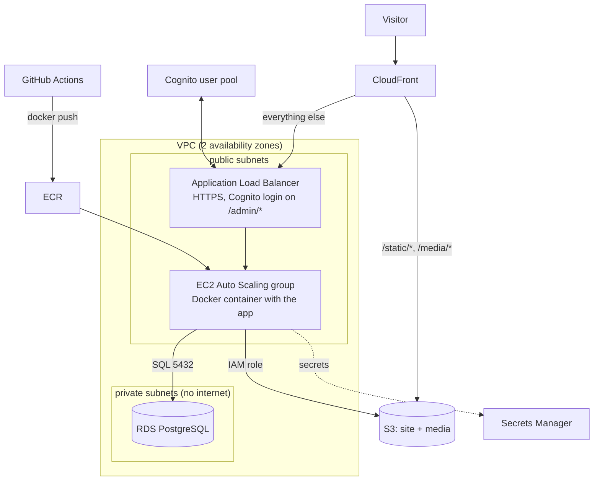

# 4. Roadmap: from static site to a full webserver

This is the plan for growing the prototype into a dynamic site with a
webserver, media storage, a Postgres database, a load balancer and logins (and
later a CMS). Each phase is one pull request (or a few), adds one module, and
leaves the site working. Costs are rough monthly figures for eu-central-1 at
hobby traffic, checked October 2026. Verify with the
[AWS Pricing Calculator](https://calculator.aws/) or with Infracost (phase 1).

## Target architecture (end of phase 5)



## Module layout at the end

```
infra/modules/aws/
  static-site/     exists: S3 + CloudFront (+ domain)
  monitoring/      exists: dashboard, alarms, budget (grows each phase)
  network/         phase 1: VPC, subnets, security groups, S3 endpoint
  webserver/       phase 2: ECR, launch template, Auto Scaling group, IAM, SSM
  media/           phase 3: media bucket, CORS, lifecycle, CloudFront path
  database/        phase 4: RDS Postgres, subnet group, secret, backups
  edge/            phase 5: ALB, certificate, listener rules, Cognito
```

`infra/live/main.tf` grows one `module` block per phase, wired together by
outputs (for example `module.network.private_subnet_ids` into the database).

---

## Phase 1: foundations for dynamic workloads (~0 USD)

Nothing user-visible, but everything later depends on it.

1. **Network module.** A VPC with two public and two private subnets across two
   availability zones (RDS requires two, even for a single instance).
   **No NAT gateway** (it costs ~35 USD/mo, more than the rest of the platform).
   Instead: the webserver lives in public subnets, locked down by security
   groups; the database lives in private subnets and never needs internet; a
   free S3 gateway endpoint keeps S3 traffic inside AWS.
2. **Deploy-role IAM permissions.** Phase 2 creates IAM roles for EC2, which
   PowerUserAccess cannot do. Add a scoped policy to the deploy role in
   `infra/bootstrap/main.tf`: allow `iam:CreateRole`, `iam:PassRole` and friends
   only for roles under the path `/modern-web/`, and require a permissions
   boundary so CI can never create an admin role.
3. **Environments.** Introduce `dev` next to `prod`: either a second folder
   (`infra/live-dev`) or one folder with `-var-file=dev.tfvars` and a different
   state key. Dev can use smaller sizes and be switched off at night.
   Recommendation: separate tfvars + state keys, same code.
4. **Better PR checks.** Add to `ci.yml`: `tflint` (catches invalid instance
   types and deprecated arguments), `trivy config` or `checkov` (security
   misconfigurations), `terraform test` for module unit tests, and
   **Infracost**, which comments "this PR changes your monthly bill by
   +17.20 USD". That last one is the best cost-overview tool for this project.

**Learn:** VPC/CIDR basics, security groups vs. NACLs, `cidrsubnet()`, data
source `aws_availability_zones`, permissions boundaries.

---

## Phase 2: webserver on EC2 (~8 to 12 USD)

Goal: a small app (start with "hello from the server" in any language) runs
on EC2 and is served through the existing CloudFront under `/` while static
files keep coming from S3.

**Design decisions**

- **Run the app as a Docker container.** You already plan to use Docker
  locally (Postgres). If the app is a container too, laptop and server run the
  same image, and moving to ECS Fargate or another cloud later is easy.
- **Auto Scaling group with min = max = 1**, not a lone instance. If the
  instance dies or fails health checks, AWS replaces it automatically. That is
  most of "server maintenance" for free.
- **Instance type** `t4g.small` (ARM, 2 GB RAM, ~12 USD) or `t4g.micro`
  (1 GB, ~6 USD). Build the image for `linux/arm64`.
- **No SSH.** Use SSM Session Manager (`aws ssm start-session`): no port 22, no
  keys to lose, every session is logged.
- **Origin protection.** Until the load balancer arrives, CloudFront talks to
  the instance directly. The security group allows port 80 only from the AWS
  managed prefix list `com.amazonaws.global.cloudfront.origin-facing`, so
  nobody can bypass the CDN.

**Terraform resources**

`aws_ecr_repository` (+ lifecycle policy keeping the last 10 images),
`aws_iam_role` + `aws_iam_instance_profile` (policies:
`AmazonSSMManagedInstanceCore`, `CloudWatchAgentServerPolicy`, ECR pull),
`aws_launch_template` (Amazon Linux 2023 AMI looked up with
`data "aws_ssm_parameter"`, `user_data` from a `templatefile()` cloud-init
script that installs Docker, logs in to ECR and starts the container as a
systemd service), `aws_autoscaling_group`, `aws_security_group`,
`aws_eip` (stable origin address), a second `origin` + `ordered_cache_behavior`
in the CloudFront distribution.

**CI/CD changes**

- New job: build the image, run the app's tests inside it, push to ECR tagged
  with the git SHA.
- Deploy: Terraform gets the image tag as a variable; changing it updates the
  launch template, and an ASG **instance refresh** rolls the new version out.
  (Faster alternative: SSM Run Command does `docker pull && restart`.)

**Maintenance**

- OS patches: SSM Patch Manager with a weekly maintenance window
  (`aws_ssm_maintenance_window`, `aws_ssm_patch_baseline`), or simply refresh
  the instance onto the latest AMI weekly (immutable infrastructure, preferred).
- Logs: the CloudWatch agent ships container logs to a log group with 14-day
  retention (`aws_cloudwatch_log_group`).
- Alarms: EC2 status check failed, CPU credit balance low, ASG unhealthy.
- Note: every public IPv4 address costs ~3.60 USD/mo since 2024.

**Learn:** `templatefile()`, launch templates vs. instances, instance
profiles, lifecycle `ignore_changes`, rolling deploys.

---

## Phase 3: media files in S3 (~0 to 1 USD)

Goal: PDFs and images live in S3, never on the server's disk, so the server
stays disposable.

- **Separate media bucket** (site files are wiped by `s3 sync --delete` on
  every deploy; media must not be). Versioning on, so deleted uploads can be
  recovered.
- **Two ways in:**
  1. repo-managed media: a `media/` folder synced by CI *without* `--delete`
     (fine for logos and a few PDFs; for many large files use Git LFS or
     upload directly);
  2. user uploads (CMS): the app creates a **presigned URL**, the browser
     uploads straight to S3, the server never handles the bytes.
- **Access:** the instance role may `s3:PutObject`/`GetObject` only on
  `media-bucket/*`. CloudFront serves `/media/*` from the bucket via OAC, like
  the site bucket today.
- **Lifecycle rules:** abort incomplete multipart uploads after 7 days, move
  objects untouched for 90 days to Intelligent-Tiering, expire old versions
  after 30 days.
- **CORS** on the bucket for browser uploads from your domain.
- Later, optional: a Lambda on `s3:ObjectCreated` that creates thumbnails.

**Learn:** bucket policies vs. IAM policies, `aws_s3_bucket_cors_configuration`,
`aws_s3_bucket_lifecycle_configuration`, S3 event notifications.

---

## Phase 4: PostgreSQL on RDS (~15 to 20 USD)

Goal: a managed Postgres that matches your local Docker image.

**Design decisions**

- **Same major version locally and in AWS.** Add a `docker-compose.yml` with
  `postgres:17` and set `engine_version = "17"` in Terraform. Pin the major
  version, let AWS apply minor versions (`auto_minor_version_upgrade = true`)
  in a maintenance window.
- `db.t4g.micro`, 20 GB gp3, **single-AZ** (Multi-AZ doubles the price; not
  worth it for a hobby site). New AWS accounts may have free-tier credits that
  cover this; check the current free plan.
- **Private subnets only**, `publicly_accessible = false`. Security group
  allows 5432 only from the webserver's security group (referenced by ID, not
  by IP).
- **Password never in Terraform state:** `manage_master_user_password = true`
  makes RDS generate it and keep it in Secrets Manager (~0.40 USD/mo). The app
  reads it at start-up through its instance role.
- **Safety:** `deletion_protection = true`, `skip_final_snapshot = false`,
  `backup_retention_period = 7`, `prevent_destroy` lifecycle. A plan that
  replaces the database must be impossible to merge by accident.
- **Reaching it from your laptop:** SSM port forwarding through the webserver
  (`aws ssm start-session --document-name AWS-StartPortForwardingSessionToRemoteHost`),
  then `psql` on localhost. No public database, no VPN.
- **Schema migrations** belong to the app (Alembic, Prisma, Flyway, Django
  migrations, depending on the stack) and run as a deploy step, not in
  Terraform. Terraform creates the database server; the app owns the tables.

**Alternative:** Aurora Serverless v2 can scale to zero when idle, so it costs
little when unused but needs a few seconds to wake up. Worth comparing once
you know the traffic pattern.

**Learn:** `aws_db_subnet_group`, `aws_db_parameter_group`, security group
references, managed secrets, the difference between infrastructure state and
data.

---

## Phase 5: load balancer, HTTPS and logins (~20 to 25 USD)

Goal: a proper front door, and protected areas for logged-in users (CMS
editors first, maybe visitors later). **Requires a custom domain** (Example 4
in [02-making-changes.md](02-making-changes.md)).

**Load balancer**

- `aws_lb` (Application Load Balancer) across both public subnets, a target
  group with health checks on `/health`, and the ASG registers into it. Now
  `max_size = 2` is possible: CPU-based scaling and zero-downtime instance
  refreshes.
- HTTPS listener with a regional ACM certificate (eu-central-1, separate from
  the us-east-1 one CloudFront uses); HTTP listener redirects to HTTPS.
- CloudFront stays in front: static and media paths from S3, the rest from the
  ALB. CloudFront adds a secret header that the ALB checks, so the ALB only
  answers CloudFront. Instances then accept traffic only from the ALB's
  security group.

**Authentication**

- `aws_cognito_user_pool` with email sign-in, optional MFA, password policy;
  `aws_cognito_user_pool_client`; `aws_cognito_user_pool_domain` for the
  hosted login page; groups `admins` and `editors`.
- **Two ways to use it:**
  1. **ALB-level:** a listener rule `authenticate-cognito` on `/admin/*`. The
     ALB handles the whole login flow and forwards the user's identity in the
     `x-amzn-oidc-data` header. No auth code in the app at all.
  2. **App-level:** the app does OIDC with Cognito itself. Needed for public
     sign-up, per-page permissions or an API.
  Recommendation: start with ALB-level for the CMS admin area.
- Emails: Cognito's built-in sender allows ~50 emails/day. For more, connect
  SES (`aws_sesv2_email_identity` on your domain).

**Optional hardening:** AWS WAF on CloudFront (~6 USD/mo + per rule) with
rate limiting and the AWS managed common rule set.

**Learn:** listener rules and priorities, OIDC flows, why the load balancer
is the most expensive line item.

---

## Phase 6: CMS (~0 USD extra)

With phases 2 to 5 in place, a CMS is "just another container":

- **Headless CMS** (Directus, Strapi, Payload, Wagtail): runs in the same
  Docker setup, stores content in RDS and uploads in the media bucket,
  `/admin` protected by Cognito. Quickest path.
- **Custom app** with your own admin pages: more to build, more to learn.

Either way Terraform's job is the same: environment variables in the launch
template (DB endpoint, bucket name, secret ARN), IAM permissions, and listener
rules.

---

## Phase 7: operations and cost control (ongoing)

- **Backups:** RDS automated backups plus `aws_backup_plan` for monthly
  snapshots kept 6 months; S3 versioning for media.
- **Monitoring module grows:** ALB 5xx and unhealthy host alarms, RDS CPU,
  free storage and connection alarms, EC2 status checks; all to the same SNS
  topic. Add widgets to the dashboard per phase.
- **Cost:** Infracost in PRs (phase 1), budget per environment with
  tag filters (activate the `Project` cost allocation tag with
  `aws_ce_cost_allocation_tag`), Cost Anomaly Detection
  (`aws_ce_anomaly_monitor`, free), and an EventBridge Scheduler that stops
  dev instances and the dev database at night.
- **Security baseline:** IAM Access Analyzer (free), GuardDuty (~1 to 3 USD
  at this size, optional), `trivy` image scanning in CI.

## Next evolution: no servers to maintain

Once the container works on EC2, moving it to **ECS Fargate** removes OS
patching completely (AWS runs the hosts). It costs a bit more than a t4g
instance (~10 to 15 USD for 0.25 vCPU / 0.5 GB always on) and swaps the
launch template + ASG for `aws_ecs_cluster`, `aws_ecs_task_definition` and
`aws_ecs_service`. Because phase 2 already uses containers and modules, this
is a module swap, the same move as switching clouds in
[03-switching-clouds.md](03-switching-clouds.md).

## Cost overview

| After phase | Adds | Approx. total / month |
| --- | --- | --- |
| 0 (prototype) | S3 + CloudFront + dashboard | < 1 USD |
| 0 + domain | Route 53 zone + .com | ~2 USD |
| 1 | VPC, endpoints (no NAT) | ~2 USD |
| 2 | EC2 t4g.small + public IP | ~15 USD |
| 3 | media bucket | ~16 USD |
| 4 | RDS db.t4g.micro + secret | ~32 USD |
| 5 | ALB (+ Cognito free up to 10k users) | ~52 USD |
| 7 | backups, alarms, optional WAF | ~55 to 62 USD |

Ways to stay lower: skip the ALB and keep CloudFront -> EC2 with app-level
Cognito login (saves ~18 USD), run Postgres in Docker on the same instance
instead of RDS for dev (saves ~15 USD, loses managed backups), and switch dev
off at night.
